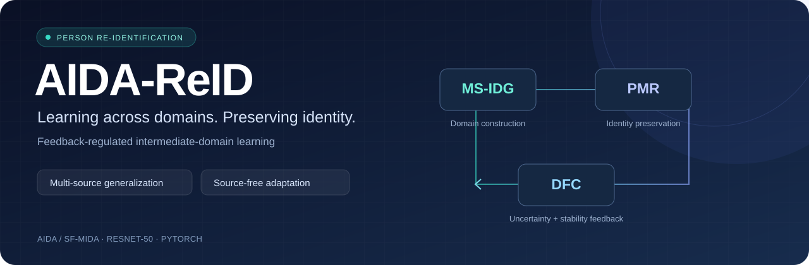

<div align="center">



# AIDA-ReID · SF-MIDA

**Feedback-Regulated Intermediate-Domain Learning for Generalizable and Source-Free Person Re-Identification**

**Sundas Iqbal · Qing Tian · Danish Ali · Jianping Gou · Weihua Ou**

[](pyproject.toml)
[](pyproject.toml)
[](#-the-method)
[](tests/test_aida.py)

[🚀 Quick start](#-quick-start) · [🧠 Method](#-the-method) · [📊 Results](#-results-reported-in-the-paper) · [📁 Data](docs/DATASETS.md) · [🔬 Experiments](docs/EXPERIMENTS.md)

</div>

---

## ✨ Overview

AIDA-ReID learns identity-discriminative representations across camera networks through a feedback-controlled domain-transition process. It couples **multi-source feature-statistics mixing**, **identity and relational consistency**, and **dynamic feedback** in one training system.

**SF-MIDA** carries the learned representation into a target-only refinement stage. It uses the pretrained model and unlabeled target training images, with epoch-wise pseudo-label clustering.

| Protocol | Training data | Deployment / evaluation |
|:--|:--|:--|
| **Domain generalization · DG** | Labeled source domains | Direct retrieval on an unseen target |
| **Source-free adaptation · SF-MIDA** | A source-pretrained model + unlabeled target images | Target retrieval after refinement |
| **Single-source UDA** | Labeled source + unlabeled target images | Target retrieval after joint adaptation |

The DG training path opens source training splits only. SF-MIDA opens only the target training split and checks checkpoint provenance to enforce target exclusion from source pretraining.

## 🚀 Quick start

### 1 · Install

Use Python 3.10 or newer and install PyTorch/torchvision for your hardware. From the repository root:

```bash
python -m venv .venv
```

Activate the environment:

```powershell
# Windows PowerShell
.venv\Scripts\Activate.ps1
```

```bash
# Linux / macOS
source .venv/bin/activate
```

Install the package and run the checks:

```bash
python -m pip install -r requirements.txt
python -m unittest discover -s tests -v
python examples/train_aida.py --list-configs
```

The main training and evaluation paths use PyTorch and NumPy operations; FAISS and a compiled Cython evaluator are optional. ImageNet weights are downloaded by torchvision on the first source-training run and reused from its cache.

### 2 · Prepare the datasets

```text
data/
├── market1501/
│   └── Market-1501-v15.09.15/
│       ├── bounding_box_train/
│       ├── query/
│       └── bounding_box_test/
├── dukemtmc/
│   └── DukeMTMC-reID/
│       ├── bounding_box_train/
│       ├── query/
│       └── bounding_box_test/
├── msmt17/
│   └── MSMT17_V1/
│       ├── train/
│       ├── test/
│       ├── list_train.txt
│       ├── list_val.txt
│       ├── list_query.txt
│       └── list_gallery.txt
├── cuhk03/
└── personx/
```

Readers also accept split folders directly inside each dataset root and CSV manifests for processed datasets. See [dataset formats and CUHK03 splits](docs/DATASETS.md).

### 3 · Train AIDA-ReID

Market-1501 + DukeMTMC-ReID → MSMT17:

```bash
python examples/train_aida.py --config-type dg --config-name market_duke_to_msmt --data-dir data --logs-dir runs/dg-msmt
```

Inspect a configuration before training:

```bash
python examples/train_aida.py --config-name market_duke_to_msmt --dry-run
```

### 4 · Evaluate a checkpoint

```bash
python examples/test.py --checkpoint runs/dg-msmt/checkpoint.pth --target msmt17 --data-dir data --output runs/dg-msmt/metrics.json
```

Evaluation reports **Rank-1, Rank-5, Rank-10, and mAP as percentages**. It removes gallery junk images and same-identity/same-camera matches, then averages over valid queries. Add `--extended` to compute NMI and silhouette.

## 🧠 The method

| Component | Role | Implementation |
|:--|:--|:--|
| **MS-IDG** | Convex mixtures of source channel statistics produce identity-preserving domain transitions. | [Feature-statistics generator](idm/models/aida.py) |
| **PMR** | Squared distance between normalized embeddings and absolute differences between pairwise distances preserve identities and geometry. | [Embedding objectives](idm/loss/aida.py) |
| **DFC** | Prediction entropy and running gradient-norm variance regulate loss weights and source-mixing coefficients. | [Feedback controller](idm/utils/dfc.py) |

### Training objective

```math
\mathcal{L}_{total}
= \mathcal{L}_{sup}
+ \lambda_{IDG}\mathcal{L}_{IDG}
+ \lambda_{PMR}\left(\mathcal{L}_{pmr}+\lambda_{rel}\mathcal{L}_{rel}\right)
```

Both original and intermediate source embeddings receive identity classification and batch-hard triplet supervision. The source generator aggregates per-image channel means and standard deviations within each domain before mixing them. Retrieval uses L2-normalized embeddings.

The ResNet-50 embedding head combines a global token with horizontal part tokens. Global and local branches use trainable experience slots and reliability values; their parameters travel with the pretrained model into SF-MIDA.

### Feedback equations

```math
\bar E = E / 10,
\qquad
\bar V = V / V_{max},
\qquad
q=(1+0.1\bar V)(1+0.5\bar E)
```

```math
\lambda_{IDG}=\operatorname{clip}(\lambda_{IDG}^{(0)}q,0,10),
\qquad
\lambda_{PMR}=\operatorname{clip}(\lambda_{PMR}^{(0)}q,0,10)
```

```math
s=\operatorname{clip}(q,1,1.5),
\qquad
\alpha_k=\operatorname{softmax}_k(s E_k/10)
```

DFC keeps the latest **100 gradient norms** and **100 variance estimates**. Completed mini-batch gradients update detached controller state for the following mini-batch. SAM uses the same controller state in both passes, updates DFC once, and preserves first-pass batch-normalization running statistics.

The [method-to-code reference](docs/METHOD.md) maps the implementation to the paper's equations and records additional configuration defaults.

## 🔄 Source-free refinement

Use a target-excluding source checkpoint:

```bash
python examples/train_aida.py --config-type sf_pretrain --config-name pretrain_for_market --data-dir data --logs-dir runs/pretrain-market
python examples/train_aida.py --config-type sf_adapt --config-name adapt_to_market --pretrained-checkpoint runs/pretrain-market/checkpoint.pth --data-dir data --logs-dir runs/sf-market
python examples/test.py --checkpoint runs/sf-market/checkpoint.pth --target market1501 --data-dir data --output runs/sf-market/metrics.json
```

At the beginning of each refinement epoch:

1. Extract current target training embeddings.
2. Compute k-reciprocal Jaccard distances.
3. Run DBSCAN with **ε = 0.6**, **min_samples = 4**, **k₁ = 30**, and **k₂ = 6**.
4. Exclude noise samples and initialize classifier rows from current cluster centroids.
5. Optimize pseudo-label classification, triplet, and DFC-weighted PMR objectives.

Target pseudo-mirrors transfer statistics between target samples in the mini-batch. Source images and source feature caches are absent from this path. Classifier rows are refreshed each epoch while backbone optimizer state is retained.

## ⚙️ Experiment settings

| Setting | DG / source pretraining | SF-MIDA | UDA |
|:--|:--:|:--:|:--:|
| Backbone | ImageNet ResNet-50 | Source-pretrained ResNet-50 | ImageNet ResNet-50 |
| Input | 256 × 128 | 256 × 128 | 256 × 128 |
| Pooling | GeM | GeM | Global average |
| Optimizer | AdamW + SAM | AdamW + SAM | AdamW |
| Learning rate | 3.5 × 10⁻⁴ | 1.0 × 10⁻⁴ | 3.5 × 10⁻⁴ |
| Weight decay | 5 × 10⁻⁴ | 5 × 10⁻⁴ | 5 × 10⁻⁴ |
| Batch size | 64 | 64 | 64 total, split equally |
| Epochs | 50 | 30 | 60 |
| Initial IDG / PMR weights | 1.0 / 1.0 | 1.0 / 1.0 | 1.0 / 1.0 |

All source protocols use a supervised stage followed by intermediate-domain learning. The default source schedule allocates the first 10 epochs to supervised learning. Additional defaults, source combinations, per-component switches, and reproducible commands are in [the experiment guide](docs/EXPERIMENTS.md).

Override values through typed `KEY=VALUE` arguments:

```bash
python examples/train_aida.py --config-name duke_msmt_to_market --override seed=2 workers=0 iters=400
```

Boolean overrides use lowercase JSON values, such as `use_sam=false`.

### Single-source UDA

```bash
python examples/train_idm.py --config-name market1501_to_dukemtmc --data-dir data --logs-dir runs/uda-market-duke
```

The joint UDA path uses separate source/target normalization, global average pooling, learned pairwise intermediate features, bridge probability/feature objectives, diversity regularization, and AdaIN pseudo-mirrors. Target labels come from epoch-wise clustering.

## 📊 Results reported in the paper

These tables reproduce the manuscript's reported measurements. Training writes its own loss logs and checkpoints; evaluation computes and writes fresh metrics from the selected checkpoint.

### Multi-source domain generalization · Table 2

| Labeled training sources | Unseen target | Rank-1 ↑ | mAP ↑ |
|:--|:--|--:|--:|
| Market + Duke | MSMT17 | 57.8 ± 0.4 | 39.9 ± 0.3 |
| Market + MSMT17 | Duke | 78.5 ± 0.3 | 64.3 ± 0.3 |
| Duke + MSMT17 | Market | 89.7 ± 0.2 | 76.8 ± 0.2 |
| Market + Duke + MSMT17 | CUHK03 | 51.3 ± 0.5 | 49.9 ± 0.4 |

### Source-free adaptation · Table 3

| Target | Excluded from labeled pretraining | Rank-1 ↑ | mAP ↑ |
|:--|:--|--:|--:|
| Market-1501 | Market-1501 | 97.2 ± 0.2 | 86.4 ± 0.3 |
| DukeMTMC-ReID | DukeMTMC-ReID | 95.4 ± 0.3 | 84.8 ± 0.3 |
| MSMT17 | MSMT17 | 69.1 ± 0.5 | 59.5 ± 0.4 |

### Single-source UDA · Table 4

| Transfer | Rank-1 ↑ | mAP ↑ |
|:--|--:|--:|
| Market → Duke | 92.5 | 84.9 |
| Duke → Market | 95.3 | 89.2 |
| Market → MSMT17 | 72.1 | 58.9 |
| Duke → MSMT17 | 73.5 | 46.1 |
| MSMT17 → Duke | 86.7 | 75.9 |
| MSMT17 → Market | 96.8 | 89.6 |

## 🔬 Ablations & analysis

Select individual components using `--ablation`:

```bash
python examples/train_aida.py --config-name market_duke_to_msmt --ablation ms_idg --logs-dir runs/ablation-msidg
python examples/train_aida.py --config-name market_duke_to_msmt --ablation ms_idg_identity --logs-dir runs/ablation-identity
python examples/train_aida.py --config-name market_duke_to_msmt --ablation ms_idg_relational --logs-dir runs/ablation-relational
python examples/train_aida.py --config-name market_duke_to_msmt --ablation aida_full --logs-dir runs/ablation-full
```

Use [the experiment guide](docs/EXPERIMENTS.md) for paired runs, mean/standard-deviation aggregation, feature plots, and baseline commands.

## 🗂️ Repository map

```text
AIDA-SF-MIDA/
├── assets/                 # Repository artwork
├── docs/                   # Data, equations, experiment recipes
├── examples/               # Training, evaluation, analysis, visualization
├── idm/
│   ├── configs/            # DG, SF, UDA, and component presets
│   ├── datasets/           # Folder, CSV, and MSMT17 readers
│   ├── models/             # ResNet, pooling, MS-IDG, normalization
│   ├── loss/               # Classification, triplet, and PMR
│   ├── utils/              # DFC, SAM, Jaccard, analysis utilities
│   ├── data.py             # Domain/identity-balanced batches
│   ├── clustering.py       # Target pseudo-label generation
│   ├── trainers.py         # Objectives and optimizer updates
│   ├── evaluators.py       # Retrieval metrics
│   └── engine.py           # Protocols and checkpoint orchestration
├── tests/                  # Numerical and protocol regression checks
├── pyproject.toml
└── requirements.txt
```

Each training run produces `config.json`, `train.jsonl`, and `checkpoint.pth`. Resume a run with the same configuration and `--resume PATH`. Keep dataset splits, seeds, pretrained initialization, and all overrides with the checkpoint.

## 📚 Citation

```bibtex
@misc{iqbal2026aidareid,
  title  = {AIDA-ReID: Feedback-Regulated Intermediate-Domain Learning
            for Generalizable and Source-Free Person Re-Identification},
  author = {Iqbal, Sundas and Tian, Qing and Ali, Danish
            and Gou, Jianping and Ou, Weihua},
  year   = {2026}
}
```

## 🤝 Acknowledgments & contact

This repository builds on the IDM/IDM++ person Re-ID code lineage and k-reciprocal re-ranking. Original source attribution is retained in the corresponding utilities. Dataset access and redistribution follow each dataset owner's terms; datasets and trained weights are supplied separately.

**Sundas Iqbal:** [sundasiqbal058@gmail.com](mailto:sundasiqbal058@gmail.com)  
**Corresponding author · Qing Tian:** [tianqing@nuist.edu.cn](mailto:tianqing@nuist.edu.cn)

For implementation questions, [open an issue](https://github.com/Sundas058/AIDA-SF-MIDA/issues) with the command, resolved configuration, environment versions, and error log.

